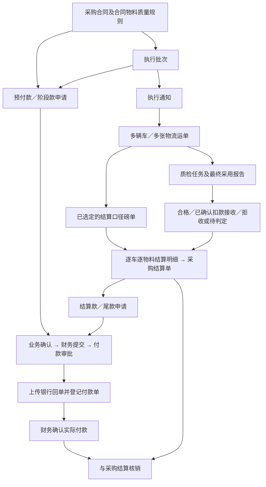

# 采购付款与质量结算联动产品及开发方案

> 状态：产品方案，含已确认口径及待定事项；本文不是已上线功能说明。
>
> 日期：2026-10-17。
>
> 依据：当前 RICSE 合同、执行批次、物流、磅单、质检、入库、资金结算及小程序代码。
>
> 范围：采购货款及双边合同采购侧；销售客户退款保留既有独立路径，物流运费结算不并入采购货款。

## 1. 目标和统一口径

打通“合同约定 → 实际履约与检测 → 货物结算 → 付款申请审批 → 付款登记 → 核销”的链路。付款申请能够解释本次为何付款、依据哪些货物和凭证、如何确定金额、是否已经支付过。

保留此前确定的业务灵活性：执行批次不必全部完成才能申请付款；预付、装车后付、发货后付、到货后付、质检后付和见票后付均可按合同及审批处理。系统不以某个固定物流或入库状态限制所有付款。

质量影响哪一部分货款，就控制哪一部分；一车或一批有争议，不自动锁死合同下所有其他货物和所有付款阶段。

2026-10-17业务确认：扣款接收由结算制单人或付款申请发起人明确确认，使用已经确定的磅单及最终质检依据；质保金按尾款处理。以下方案已按这两项结论更新，实现前的现有权限和入口不代表目标口径。

### 1.1 四种单据和金额

| 对象 | 回答的问题 | 金额含义 |
|---|---|---|
| 合同 | 双方约定如何交易 | 约定数量、价格、质量规则、付款方式及条款 |
| 采购结算单 | 指定货物最终或阶段性应付多少 | 货物原金额、质量价格扣款、其他调整、确认后的结算金额 |
| 付款申请单 | 这次申请付多少、为何现在付 | 申请金额、阶段和触发依据、历史支付及占用、审批结果 |
| 付款单 | 实际付出了多少 | 实际付款双方及账户、金额、时间、银行回单、财务确认和核销 |

“采购结算”是业务往来金额确认，当前系统不据此自动生成会计凭证。付款申请批准不代表银行转账完成；登记付款凭证也不代表会计已复核；付款核销完成不代表整个合同履约完成。

### 1.2 付款阶段、付款依据、触发条件分开

- 付款阶段：预付款、阶段款、结算款、尾款、保证金等，沿用现有款项分类。
- 付款依据：合同约定、执行批次履约依据、已确认采购结算单。
- 触发条件：签约、装车/发货、到货、质量验收、入库、收到发票、约定日期或其他；可组合，但只判断该笔款项约定的条件。

“阶段款”可用阶段名称区分装车款、发货款、到货款，避免一开始增加大量彼此交叉的枚举。“尾款”只是款项名称，不能据此把未履约合同余额自动认作应付。

## 2. 当前系统核对结果

| 现有能力 | 当前情况 | 本次处理方向 |
|---|---|---|
| 合同质量规则 | 合同物料行已有规则快照 | 结算引用实际适用快照，不重新套当前模板 |
| 质检最终依据 | 运单级质检任务可选定已确认报告，保存判定版本、明细及元/吨扣款 | 结算引用最终采用报告与版本 |
| 扣款接收 | 已有扣款待确认和确认扣款接收，入库可继续 | 结算只采用已确认的合格或扣款接收结果 |
| 存量无规则合同 | 沿用历史质检流程 | 不强制补新规则，不按新模板追溯计算 |
| 采购结算 | 支持合同阶段、执行批次、最终及调整；批次结算汇总为一行 | 补运单/物料来源明细及质量扣款，保留批次汇总展示 |
| 付款申请 | 单合同，可选单批次、单采购结算单，业务确认后财务提交审批 | 补付款依据、条件核对、金额占用与版本校验 |
| 付款执行 | 审批申请可分次登记付款凭证，允许同主体多银行账户并记录差异 | 延用并补执行前重新校验 |
| 核销 | 已确认资金与结算单建立核销关系 | 补预付款抵扣建议和已付款未核销的防重控制 |
| 小程序审批 | 当前查询 `Approval` 合同审批；未覆盖 `PaymentRequestApproval` | 增加付款申请审批、详情和提醒 |

### 2.1 必须随本次修正的实现问题

1. 当前申请余额用“结算总额－已核销－部分状态申请全额”计算，已核销与申请可能重复扣减；`PARTIALLY_PAID` 又不在部分汇总状态中，可能遗漏部分付款申请的剩余占用。
2. 合同候选列表中的剩余付款金额是页面参考值，不能代替提交、审批和执行时的服务端校验；保存申请时未形成统一的合同级付款控制。
3. 合同最终结算当前按“合同名义金额－累计结算”生成。质量已扣款后，这种方式可能把扣减金额补回来，也可能把未履约合同数量当作尾款。
4. 合同阶段结算与实际批次结算缺少统一来源对应，存在同一货物按阶段和批次重复确认应付的风险。
5. 当前结算只汇总批次数量与单价，不能解释同批次多车不同检测结果，也不能准确锁定已经结算过的具体货物数量。
6. `confirmFund` 当前先检查功能权限，再按资金单 ID 和状态查找，未在该查询中加入对应的数据范围过滤；本次所有资金状态变更需统一核对功能权限和数据范围。
7. 候选合同列表限制合同状态，而公共合同读取方法未统一校验付款业务可操作状态；直接指定合同 ID 的写接口需补齐服务端状态校验。

上述是代码核对发现，不表示已经修复。实现时同时覆盖创建、修改、业务确认、财务提交、审批、登记付款、财务确认、核销和撤销等节点。

## 3. 单据关系和颗粒度



### 3.1 付款申请单头

一张申请固定一个合同、采购方向、我方法律主体、供应商、业务单元和币种；一期按现有人民币口径实现，不新增外币结算引擎。实际第三方收款继续独立标记并审批，合同供应商身份不被替换。

一张申请对应一个明确阶段和一种付款依据。结算类申请一期关联一张采购结算单，该结算单可以包含同合同多个执行批次、多个运单。合同预付款不必绑定批次；按批次发起的阶段款一期绑定一个批次，并可选择批次下相关运单作为凭证依据。

一张申请可以分次登记多张付款单。多合同、多法律主体、多供应商、多业务单元不合并在同一申请中。

### 3.2 货物结算明细

采购结算的计算细度为“合同物料行 + 执行批次 + 运单货物行 + 本次结算数量”。由此关联执行通知、结算磅单、质检任务和最终依据报告。列表仍按批次汇总，展开查看各车明细。

- 同批次五辆车可以分批结算，不要求五辆车都质检完成。
- 合格与已确认扣款接收的货物可分别进入结算；待判定和拒收货物排除，并显示原因。
- 一份检测报告属于某车质检任务，不默认适用于同合同或同批次其他车辆。
- 同一来源允许分次结算数量，累计不能超过该来源可结算数量；草稿占用与正式结算分开显示，作废或删除草稿释放占用。
- 直接按合同或批次提前付款可以形成付款申请；不为支持预付款而重复生成“最终货物应付”。

现有质检任务按运单首个物料行匹配规则。单车混装多物料时，不能把一个结果用于所有物料；一期识别此情况并提示补齐按物料验收依据，自动质量结算不对不明确的物料运行。完整混装质检模型另行扩展。

## 4. 实际场景与付款条件

| 场景 | 应选择的依据 | 需要核对 | 允许付款申请的口径 |
|---|---|---|---|
| 签约后先付货款 | 合同 | 已生效合同、预付约定、累计付款及申请 | 无需先有磅单、质检、入库或正式货物结算 |
| 提货前备款 | 合同或执行批次 | 提货计划、合同约定、申请用途 | 保存草稿并完善；财务提交时确认付款依据 |
| 装车／发货后付 | 执行批次 | 选定运单、发货事实、必要的发货磅单或凭证 | 不一概要求目的地质检、入库完成 |
| 到货后付 | 执行批次或采购结算 | 到达/签收事实，以及该笔款项是否另有质量条件 | 到货、签收、入库是不同节点，按实际条款选择 |
| 质检合格后付 | 采购结算 | 最终依据报告、合格接收结果、结算重量和金额 | 只申请符合条件的货物金额 |
| 按合同扣款后接收并付款 | 采购结算 | 已确认扣款接收、扣款规则及元/吨计算 | 使用已扣款的结算金额，申请页面不重复手填扣款 |
| 见票后付 | 上述依据加发票条件 | 发票是否收到、票面主体/金额及附件 | 一期人工复核并记录，不声称已做税务验真 |
| 结算尾款 | 已确认采购结算 | 实际结算、已付款、预付款抵扣、其他申请占用 | 申请当前未结且未被占用的余额，可部分申请 |
| 质保金支付 | 采购结算下尚未支付的尾款 | 合同约定、应付余额、其他已申请金额 | 使用尾款类型，在用途/阶段名称注明质保金，沿用尾款申请、审批、付款和核销 |
| 采购保证金 | 合同、保证金约定 | 与货款分账、退回条件 | 沿用保证金类别，不与货款核销 |
| 已预付，但拒收或最终应付减少 | 原付款及相关合同 | 已付、应付、应退金额 | 不再生成负付款申请；按供应商退款与原付款关联处理 |

“应付尾款中暂扣的质保金”与“另行支付给对方的履约保证金”含义不同。现有 `GUARANTEE` 用于保证金独立往来，不直接拿来表示货款尾款暂扣。

### 4.1 质量条件的明确边界

- `PASS`：可作为合格货物结算依据。
- `ACCEPT_WITH_DEDUCTION`：可按已确认合同扣款结算。
- `DEDUCTION_PENDING`：尚未接受货物商务处置，不能作为正式质量结算依据。
- `REJECT`、`REVIEW_REQUIRED`、质检未完成：该部分不进入正常质量结算；不得靠修改付款阶段把拒收货物改成已验收。
- `LEGACY`：展示历史验收依据，允许人工复核处理，不自动补造合同扣款规则。

扣款接收的商务决定由结算制单人或付款申请发起人确认。质检人员负责报告、实测值和最终检测依据；结算/申请人员查看既有依据及合同自动计算结果后，明确选择“确认按合同扣款接收”。不要求另行找质检人员作商务确认，也不新增独立审批节点。

具体交互与约束：

- 在编制采购结算和付款申请的质量依据明细中显示“待确认扣款接收”，支持查看合同规则、已选磅单、最终采用报告及扣款计算；点击确认时填写或确认业务处置说明，保存确认人、时间及来源版本。
- 磅单和最终质检依据沿用原单已确认结果，结算/申请人员不能通过此动作重选报告、修改实测值或任意改写合同扣款。
- 以独立的商务处置确认权限授权承担结算制单或付款申请发起职责的内部岗位；确认时检查目标合同及相应业务单元范围，不通过授予完整 `quality.manage` 实现。不因只具备查看权限就允许确认。
- 确认是独立、显式的操作，不因保存草稿、提交申请或审批通过而自动发生。只允许处理已完成检测且处于 `DEDUCTION_PENDING` 的货物；拒收、待判定或缺失检测依据不能直接按普通扣款接收放行。
- 确认后更新同一质检任务的商务处置结果为 `ACCEPT_WITH_DEDUCTION`，继续沿用既有入库放行和后续结算机制；不会因此自动确认应付、提交付款审批或登记付款。
- 入库可能早于编制结算/申请：在已有任务/验收详情保留相同的商务确认入口，供上述有权限人员提前确认，不要求先创建结算单或付款申请才能入库。不同入口调用同一个确认动作，已确认结果统一展示，不重复要求操作。

质量验收与库存过账分别展示。预付款、阶段款按约定条件申请，不统一等待入库；最终采购货物结算按已完成的实际入库过账数量，未过账不形成最终货物应付。

## 5. 金额计算、防重复和预付款处理

### 5.1 结算数量和质量扣款

```text
本次货物原金额 = 本次结算数量 × 合同适用单价
本次质量价格扣款 = 本次合同约定计价吨数 × 已确认质量扣款（元/吨）
本次货物结算金额 = 原金额 − 质量价格扣款 + 其他经确认调整
```

最终采购结算数量引用有效 `BusinessInbound.quantity`，关联过账时的结算入库磅单；不直接取计划数量或磅单最新净重替代。采购不另选货款磅单，入库已冲销的来源须先处理更正。销售的我方出库与客户货款依据可以不同；物流运费另行选择，不反向修改货款或库存。

扣水、扣杂造成的数量变化与元/吨价格扣款分别列明；同一指标只有合同明确约定同时作用时才允许双重调整。系统不得对已有 `settlementWeight` 再机械重复扣水。每条规则明确计价数量和计算次序，无法确定时转人工确认。

合同质量快照给出什么公式就用什么公式；付款模块不改变边界、线性或整档算法。单价沿用合同既有含税/未税口径，一期不根据发票重新推算税额。

### 5.2 预付款抵扣只影响剩余待付，不改变货物结算金额

例：实际结算100吨，合同单价2,000元/吨，质量扣款40元/吨：

| 项目 | 金额 |
|---|---:|
| 货物原金额 | 200,000元 |
| 质量价格扣款 | −4,000元 |
| 确认货物结算金额 | 196,000元 |
| 已确认预付款并核销到本结算 | 60,000元 |
| 本结算未结余额 | 136,000元 |
| 已有有效申请剩余占用 | 100,000元 |
| 本次最多可再申请 | 36,000元 |

不得把预付款先从196,000元中扣减形成136,000元应付，再用60,000元预付款核销一次。预付款是已付资金，通过核销减少未结余额。

一期提供“选择可抵扣预付款 → 展示抵扣建议 → 财务确认核销”的交互，不在查看页面时自动创建核销记录。未核销预付款默认不能被当作“尚未支付”忽略：财务提交尾款前，明确选择抵扣到本结算，或保留给其他批次并记录资金用途；同笔余额不能重复分配。

### 5.3 统一金额占用

金额分成：草稿参考、有效申请未登记付款、已登记付款待财务确认、财务已确认未核销、已核销、已退款、保证金独立往来。

- 不完整业务草稿可保存，不长期锁定资金；显示其他草稿参考，正式占用从“业务确认交财务”开始。
- 业务已确认、审批中、已批准的剩余申请金额占用对应付款依据额度；审批驳回或作废释放尚未登记付款部分。
- 登记付款后，申请的相应金额从“未执行申请占用”转为“已登记付款占用”，不是额外再占用一次；待财务确认的付款仍阻止重复申请。
- 财务确认和核销只在不同余额桶间移动同一金额，不能让同一笔资金从防重控制中消失。
- 部分付款申请同时保留“已登记部分”和“剩余批准部分”，两者合计仍只占该申请批准金额。
- 草稿付款单、作废付款单、撤销核销、退款分别按真实状态回算；作废记录不抹掉审计痕迹。

结算级可再申请额以“结算总额－已核销－指向该结算的未核销付款占用－有效申请未执行占用”为基础；合同级同时检查全部货款净支付、有效申请剩余及跨结算预付款分配，不与结算级余额重复相减。

正式实现采用付款依据金额分配明细承载占用，不能继续靠若干状态名称求和猜测。按同一合同/结算串行锁定或使用可串行化事务及重试，防止两人同时通过相同额度。创建、提交、审批和执行均重算，自身当前占用应排除后再比较。

### 5.4 合同额度和最终结算

- 合同名义总金额是基准，现有溢短装、实际结算重量、质量扣款和已批准补差共同影响最终应付；不简单用合同总额减累计单据作为最终货款。
- 自动付款上限仅采用合同中已明确确认的规则或已经确认的应付依据。溢短装允许数量偏差不自动授权超额支付，超额需有相应确认依据。
- 合同付款条款没有明确比例时，不擅自生成30%、70%等默认约定；由业务填写申请依据、财务和既有节点审核确认。
- 已按阶段形成的历史正式应付要先映射到具体履约或转为明确的调整处理；不能再对同一货物全额生成批次结算。
- 合同剩余未执行数量不自动转成尾款；最终结算应汇总实际结算来源和有效调整。
- 若质量扣款或退货导致已付款超过最终应付，显示超付及应收回金额，暂停新增普通货款支付并走退款处理。

## 6. Web 交互

### 6.1 导航和入口

继续沿用“资金结算 → 应付管理”，页面顶部两个标签“付款申请单”“付款单”，不新增侧边栏层级。

付款申请列表支持合同、申请编号、我方主体、供应商模糊搜索及业务单元、付款阶段、状态筛选。合同详情和执行批次详情提供“申请付款”快捷入口，采购结算详情提供“按本结算申请付款”。

采购结算单是本次采购货物的金额确认依据：在「资金结算」下依次提供「付款申请单」「采购结算单」「付款单」三个独立二级菜单，三列表页面主标题统一为“应付管理”，顶部标签与侧边栏同名同序。采购结算单不是执行批次，也不是未来付款计划。从申请编辑页、合同或批次资金区域保留“查看/编制采购结算”快捷入口；未确认结算草稿不伪装成可支付的正式结算。保持单据独立编号、详情及打印，菜单沿用`settlement.view`权限。

### 6.2 独立申请编辑页

从现有新建弹窗调整为 `/dashboard/payment-requests/new` 和独立草稿编辑页。使用一个页面按顺序分区，避免多次点击“下一步”造成现场操作负担：

1. **申请归属**：可先按我方主体、交易对手筛选，再通过下拉框选择合同，也可不筛选直接选择。不再提供单独的“查找合同”输入框；从合同、批次或结算详情进入时保留自动关联。自动带出我方主体、供应商、业务单元、合同及附件入口。付款申请列表的关键词搜索保持不变。
2. **本次付款依据**：选择付款阶段、阶段名称及依据类型。选择执行批次或已确认采购结算；从源单进入时预填。展示合同付款原文及已配置预付比例、账期，不把自由文本自动解析成可靠条件。
3. **业务进度与质量**：展示相关运单、发货、到货、签收、质检、入库状态。按本次付款条件突出需核对项；点击进入原始磅单、报告、接收决定和结算明细。非本次必需项标为“供参考”。
4. **金额与抵扣**：展示原金额、质量扣款、其他调整、结算净额、已付、预付款、占用及可申请额。申请人填写本次金额。质量计算只读；纠错回源单或正式调整，不在申请页覆盖质检事实。
5. **付款账户与凭证**：计划日期、付款方式、用途、双方有效银行账户、第三方收款说明和业务依据附件。每项账户信息支持复制；计划账户保存快照。
6. **核对与操作**：展示未满足条件和处理入口；底部提供“保存草稿”“确认资料并交财务”。离开未保存页面提示保存；校验失败保留所有输入并定位字段。

财务查看独立详情，核对预付款和付款依据后“提交审批”或“退回业务完善”。草稿保存不因缺少未来检测报告被阻止；正式结算、财务提交及实际付款按各自节点校验。

### 6.3 条件核对方式

一期不新增复杂合同付款条件引擎。申请记录本次付款条件快照及依据：条件类型、说明、关联单据、系统核验结果、人工核对人和时间。

- 系统已有可靠事实，如运单已发货、最终质量处置，可以直接展示核验结果。
- 发票、线下对账等未形成可靠系统事实的条件，以附件、说明和财务复核确认；上传附件不自动标成已验真。
- 缺少普通业务凭证可保存草稿；是否允许按约定先付由财务及既有审批链判断并留理由。
- 跨主体/跨业务单元、重复占用、超已批准金额、无效采购结算、质量结算依据拒收或待判定、关键依据版本失效属于硬校验，不以填写普通备注绕过。

### 6.4 审批、付款单和核销

- 业务创建并确认 → 财务复核提交 → 按系统配置的付款申请流程审批；默认“风控/财务经理 → 业务责任人 → 总经理”，责任人继续按业务单元解析。
- 业务确认不额外生成一个“运营经理审批”节点；业务发起与正式审批分别留痕。
- 审批页先展示本次申请金额及条件，再展示质量扣款、预付款抵扣、相关凭证和历史资金，避免审批人只看到总金额。
- 付款单仍进入独立创建页，从已批准申请带出基本信息；凭证图片/PDF上传或粘贴后可手工录入，OCR可用时辅助填写，不要求OCR已配置才能付款登记。
- 登记付款单只记录线下已发生转账，不连接网银自动打款。实际同主体其他账户沿用现有差异说明；变更交易对象或第三方收款性质需重新审批。
- 财务确认后提供明确“核销付款”入口，可从付款单或采购结算进入；核销操作使用 `settlement.allocate`，管理员查看审计，撤销使用专项权限并说明原因。
- 打印沿用独立A4页，增加付款依据、质量计算、预付款抵扣、金额占用摘要和审批快照，不把实时变化数据重写进历史打印件。

## 7. 小程序范围

当前审批列表/详情围绕合同，需显式增加付款申请类型；不能把付款审批伪装成合同审批或仅增加一张统计卡。

一期与Web同时交付：

1. 工作台“待审批”显示合同和付款申请分类，数量与落地列表使用同一查询；已办记录保留单据类型。
2. 付款申请独立移动详情，展示双方主体、业务单元、阶段、金额、付款条件、质量与抵扣摘要、附件和审批轨迹。
3. 审批人查看质量明细及原报告、合同条款后同意或驳回；业务单元及角色鉴权与Web一致，不能仅因能查看合同就能审批付款。
4. 复用现有订阅通知基础设施发送付款审批提醒；未获得订阅同意或发送失败时保留站内待办，不把主动微信送达作为流程推进条件。
5. 可从移动合同或批次查看关联申请和付款进度；本期完整财务制单、账户核对、付款登记和核销仍以Web为主，不默认引入小程序网银支付。

## 8. 更正、版本与历史数据

- 合同质量快照、最终报告ID、`QualityTask.decisionVersion`、有效结算磅单选用ID、结算数量与单价、每项扣款计算共同组成结算依据快照。
- 草稿重新进入时可以提示更新来源，用户确认后再计算；正式结算确认后冻结金额和来源快照。
- 结算、付款申请审批或付款后修改磅单/质检采用结果，不能静默重算已确认资金单据。源单更正时检查下游依赖，标记“依据已变更，待复核”。
- 财务提交、审批通过和登记付款前重新检查来源版本；未付部分先暂停继续执行，说明变动来源，由授权人员确认调整或重新审批。既往真实付款仍保留。
- 付款金额、收款主体、质量依据、结算依据等重要变化需重新审批；普通备注的修订记录留痕。
- 已登记实际付款不能靠删除申请抵消；作废资金单仅用于错误登记，真实退回资金应登记退款并对应原付款。
- 老合同无质量快照保留人工核对路径；老结算、老付款不自动改金额或补规则。历史无明细映射的数据明确标注“历史人工依据”，要求复核后再产生新自动质量结算。
- 已执行批次的阶段应付与货物结算存在重叠时逐单处理，不批量删除历史数据或自动补零。

## 9. 技术开发设计

### 9.1 模型增量建议

以下是建议名称，实现时按最终字段设计评审；复用现有主单，不新增重复付款管理模块。

| 模型/区域 | 建议增量 | 用途 |
|---|---|---|
| `FinancialSettlementLine` | 合同物料行、批次物料行、运单货物行、物料、来源类型 | 由批次汇总扩展成可追溯货物明细 |
| 结算依据明细 | 结算磅单选用ID、质检任务/采用报告/判定版本、数量和规则计算快照、依据版本状态 | 逐车计算、部分结算、防重复、打印归档 |
| 结算金额 | 原金额、质量扣款金额、其他调整金额分列 | 防止质量扣款重复计入普通加减项 |
| `PaymentRequest` | 依据类型、阶段名称、条件及复核快照、金额计算快照、来源版本状态、请求幂等标识 | 解释付款原因并冻结审批内容 |
| 付款依据金额分配明细 | 申请、合同阶段/批次/结算目标、批准额、已登记付款、已核销映射及释放状态 | 统一预付款分配、余额占用和部分付款 |
| `FundTransaction` / `SettlementAllocation` | 延用现有模型，补关联分配/撤销映射、幂等与版本校验 | 明确已付资金与应付核销对应，不重复扣余额 |

结算金额精度到分、重量沿用三位小数、单价及元/吨扣款保留四位；中间计算使用Decimal，最终按确定的舍入规则出金额。非吨物料的元/吨规则须有明确换算，不能直接乘袋数。

源单ID必须是可校验的关联关系，不能只存展示JSON。快照保存历史内容，关系键用于权限、归属、版本和重复数量控制。

### 9.2 后端职责及接口

- 新增或拆出结算依据解析、质量结算计算、付款余额占用三个服务，避免继续把全部逻辑堆在单个结算服务中。
- 提供付款上下文接口：按合同/批次/结算返回付款原文、可选来源、质量状态、历史资金和条件核对；按目标写权限收口候选数据。
- 提供结算预览接口：前端只传来源及本次数量，后端读取合同价格和质量规则计算，不接受客户端传来的自动扣款汇总作为事实。
- 提供付款申请预检接口：返回具体缺项、阻断原因、参考提示及金额明细。创建/提交/审批/执行仍各自校验，不能信任预检结果长期有效。
- 创建、业务确认、财务提交、审批、登记付款、确认资金、核销/撤销均使用统一的范围、状态、幂等及金额占用逻辑。
- 同合同/结算/资金并发修改按固定顺序锁定，事务中重读额度，配合唯一请求号和安全重试，避免并发超付、重复核销、回单重复登记。
- 所有列表、统计、候选、附件、打印和写入统一继承合同及目标功能权限的数据范围，受用户所属业务单元上限限制；外部企业不因新增移动入口获得内部付款审批权限。

### 9.3 Web改动位置

- 合同与批次资金区域：付款快捷入口和付款约定/进度摘要。
- `components/settlement/settlement-workbench.tsx`：按来源编制结算、逐车质量明细、预览和确认。
- `components/settlement/payment-request-workbench.tsx`：保留列表，创建编辑迁移到独立页。
- `dashboard/payment-requests/[id]`及打印页：付款依据、条件核对、扣款、预付款、审批和依据变动提示。
- 付款单创建、详情和资金台账：统一金额桶、实际付款双方、核销入口、历史与当前状态分离。
- 日期、附件、提示、状态字体、采购红色系/销售蓝色系沿用全平台规范。

### 9.4 移动改动位置

- `mobile-workspace`服务、控制器：独立付款申请列表/详情/审批，复用财务业务服务及`PaymentRequestApproval`任务；保留合同接口兼容。
- 工作台待办汇总：按类型查询、按当前有效节点去重，卡片数量与列表条件一致。
- 小程序审批列表/详情：支持合同和付款申请两类页面及参数，增加质量与资金只读摘要和附件查看。
- 通知服务：按付款节点责任人生成站内待办、订阅消息及正确的付款详情跳转。

## 10. 开发顺序与交付

| 阶段 | 交付内容 | 完成标准 |
|---|---|---|
| A：统一余额及权限 | 状态修正、申请/资金占用、服务端额度、确认/核销权限与并发控制 | 部分付款、重复提交、跨事业部请求不会漏算或越权 |
| B：质量进入采购结算 | 来源明细、选用磅单和报告、规则快照、扣款计算、部分数量结算、历史兼容 | 多车不同结果能分别计算，不会补回扣款或重复确认应付 |
| C：付款申请交互 | 独立创建编辑、依据选择、条件核对、预付款抵扣、审批和打印 | 预付、发货款、扣款后尾款可走完Web全流程 |
| D：移动审批及联调 | 付款待办、详情、审批、通知、业务源单跳转 | Web与小程序待办一致，移动审批推动同一付款流程 |

按依赖顺序实施，作为一个完整迭代验收。上述分阶段用于开发组织，不把缺少防重或缺少质量依据的半成品当作完成上线。

暂缓：完整合同付款里程碑配置引擎、发票验真与自动匹配、税额重算、银行直连自动付款、资金自动调拨、融资支付细分、复杂质保金自动释放、跨合同合并付款和完整混装多物料检测。

## 11. 验收场景

1. 无批次、无磅单和质检的合同预付款：可保存并按既有审批批准后登记付款，不凭空形成货物结算。
2. 同批次五辆车三辆已验收、两辆待判定：只选三辆形成结算并申请；后两辆不阻断已合格货物。
3. 一辆合格、一辆扣款接收：各自使用对应报告和磅单，不用批次平均质量替代。
4. 报告未确认、扣款未接收或拒收：不能进入该部分的正式质量结算；合同允许的其他阶段款仍按对应依据处理。
5. 同车部分数量分次结算：不能超过来源数量；换申请或换批次入口不能重复结算同一数量。
6. 100吨×2,000元/吨、扣40元/吨、预付60,000元：应付196,000元，核销预付后未结136,000元，不重复抵扣。
7. 原申请100,000元已登记30,000元未确认：仍占100,000元，其中70,000元为未执行申请；不会因部分付款状态释放全部额度。
8. 财务确认/核销部分资金后，已付、待核销与申请占用不重复相减，也不重复释放。
9. 同时提交两个各80,000元申请或两个付款/核销请求：余额仅100,000元时不能同时成功；网络重试不重复生成单据。
10. 已审批后更换质检依据或结算磅单：历史金额不变，未付部分提示依据变动并暂停至复核。
11. 合同原金额200,000元、实际扣款4,000元且已结算196,000元：最终结算不得再自动生成4,000元尾款；未执行合同数量亦不得自动结算。
12. 同主体换银行账户记录说明可登记，跨主体或改变第三方收款性质不能直接沿用原批准申请。
13. 玉门审批、龙游只读账号：两端只能处理玉门审批；直接调用资金确认、附件和打印接口不能越权。
14. 老合同无质量规则、老结算已付款：金额不自动变化；新数据使用明确来源继续处理。
15. 小程序付款待办数与列表一致，同意/驳回与Web同步，会签/或签继续沿用现有流程。
16. 取消草稿、作废错误资金、撤销核销、真实供应商退款分别按各自动作回算并留痕。
17. 有目标事业部权限的结算制单/付款申请发起人员，可在结算、申请或既有验收入口确认扣款接收；确认不会更改磅单和报告事实，不要求先有付款申请才能入库。只读、跨事业部或拒收结果不能执行此动作。
18. 质保金选择尾款类型并注明用途，按尾款余额控制、审批、付款和核销，不作为独立保证金资金往来。

## 12. 已确认口径与其余待定事项

已确认：

| 事项 | 已确认产品口径 |
|---|---|
| 扣款接收由谁确认 | 结算制单人或付款申请发起人，基于已确定磅单和最终质检依据显式确认；入口和入库衔接见4.1 |
| 质保金的处理 | 按尾款处理，沿用尾款申请、审批、付款和核销；用途注明质保金，不单独建设释放流程 |

其余待定事项及建议默认：

| 事项 | 建议默认 |
|---|---|
| 是否必须给所有合同配置结构化付款条件 | 一期不强制；沿用合同原文，申请中记录条件和财务复核，后续按需要结构化 |
| 多批次申请 | 一张采购结算可包含同合同多批次，一张结算类申请关联一张结算；提前阶段款一期按单批次 |
| 质检完成是否必须等待入库过账才能结算/申请 | 最终采购货物结算按实际入库过账；预付款、阶段款仍按申请约定条件判断 |
| 预付款分配到具体结算的方式 | 提供建议，由财务确认核销或明确保留给其他批次，不静默自动抵扣 |
| 已预付超过扣款后最终应付 | 显示超付并阻止新增普通货款，关联原付款处理供应商退款 |
| 规则有价格扣款又有扣重 | 必须依据合同明确是否同时适用及计算顺序，未确认时人工核对，不默认双扣 |
| 小程序的本次范围 | 审批、查询、依据附件和提醒同步；财务制单、付款登记与核销以Web为主 |

本文件确认后，再更新使用指南、模块技术设计、接口契约、迁移说明及测试清单；未定事项保持显式记录，不把讨论建议写成已生效合同条款。

## 13. 相关文档与核对代码

- [合同质量结算规则与扣款接收方案](./合同质量结算规则与扣款接收方案（讨论稿）.md)，尤其“一期开发落地”。
- [资金结算使用指南](./使用指南/结算模块.md)。
- [资金结算技术设计](../技术/模块设计/结算模块.md)。
- [权限与数据范围规范](./权限与数据范围规范.md)。
- 模型：`apps/api/prisma/schema.prisma`中的`ContractLineItem`、`QualityTask`、`WaybillWeightSelection`、`FinancialSettlementLine`、`PaymentRequest`、`FundTransaction`、`SettlementAllocation`。
- 服务：`financial-settlement.service.ts`、`quality-inspection.service.ts`、`inventory.service.ts`、`mobile-workspace.service.ts`。

## 14. 本轮开发落地（2026-10-17）

本轮已实现Web及小程序相关增量，迁移已应用到本地开发库，尚未提交、推送或部署线上。开发说明、人工测试入口、迁移顺序与限制见[开发备注](../技术/开发备注/2026-10-17_采购付款与质量结算联动.md)。

- 已补合同货款、有效申请剩余、已登记待确认、已付待核销、预付款用途及核销占用，付款申请草稿不占正式额度。
- 已补实际运单货物结算、来源数量及合同溢装控制、独立质量扣款、报告/磅单/判定版本快照与变更拦截。
- 扣款接收由有专项权限的结算/申请人员显式确认；质保金按尾款处理。
- 已补独立付款申请新建/编辑、双方下拉筛选、质量依据、抵扣、审批和打印快照；合同及批次有快捷申请入口。创建/编辑页不再提供单独的合同关键词输入框，列表关键词搜索保留。
- 小程序补付款申请待办、详情、审批、受限依据附件和提醒。财务制单与付款登记仍在Web完成。
- 已完成API全量单元测试、Web构建、小程序微信构建及真实本地数据库回滚冒烟。浏览器控制不可用，真机与纸质打印保留人工验收。
- 复杂混装、历史阶段应付自动映射、发票验真、银行直连和完整合同付款条件引擎仍不在本轮自动实现范围内。
